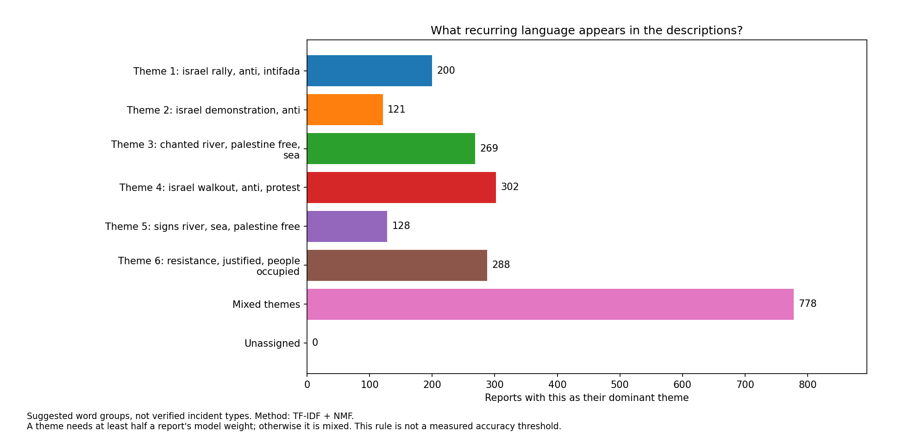
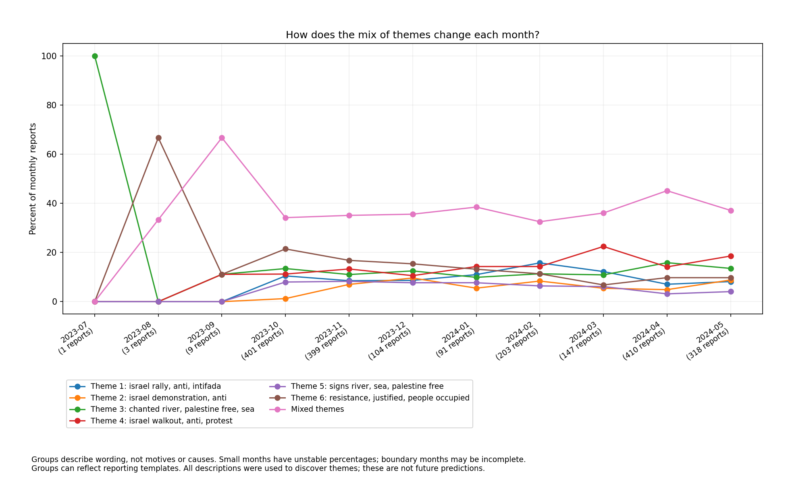

<<<<<<< HEAD
# Campus Incident Trends
=======
# Analyzing Antisemitism: Insights with ML
>>>>>>> ffac539855540711c5880744c525433d522f5015

**How did the language and types of reported campus incidents change during 2023-24?**

This project combines trend charts with machine learning that groups similar
incident descriptions. Instead of only counting reports, it explores what the
descriptions talk about and how that mix changes over time.

## Dataset

The local ADL campus-report export contains **2,086 reports**, dated
**July 11, 2023-May 31, 2024**, across **401 distinct campus labels**.
Each row contains a date, city, state, source category, description, and campus.
The source categories are Protest/Action, Harassment, Vandalism, BDS, and
Physical Assault. Protest/Action makes up **67.9%** of reports.

These are recorded reports, not a census of incidents. Raw totals do not measure
campus safety or the true prevalence of antisemitism.

## What the text analysis found

The model suggests six overlapping language groups associated with rallies,
demonstrations, walkouts/protests, chants, signs, and resistance-related slogans.
These descriptions of the groups are tentative, not independently verified labels.

<<<<<<< HEAD
- The group containing **resistance-related wording** fell from **21.4%** of
  October reports to **9.7%** in May.
- The **walkout/protest-wording group** rose from **11.2%** in October to
  **22.4%** in March.
- The **chant-wording group** increased from **16 reports in March to 65 in April**.
  Its share also increased, from **10.9% to 15.9%**.
- **37.3% of reports were mixed**, with no single theme accounting for at least
  half their model weight. This warns against forcing every report into a neat category.
=======
Major areas of focus included:
- Cleaning and normalizing raw incident rows from `data/campus_reports.csv` (2000+ individual incident reports)
- Implementing robust holiday labeling (including a canonical per-day expansion of user-provided Jewish holiday ranges)  
- Aggregating events into daily metrics and building inspection CSVs for manual review  
- Building short, executable notebooks to reproduce figures and statistical tests  
- Structuring outputs and models so results are easy to share (`outputs/`, `models/`)  
- Designing the code so it runs portably (parquet→CSV fallback, venv-aware instructions)
>>>>>>> ffac539855540711c5880744c525433d522f5015

These numbers refer to the model's strongest-match groups, not every report
mentioning a word. They are exploratory findings to check against the descriptions,
not evidence of causes, motives, or changes in severity.

## Visualizations

Start with [recurring description themes](visualizations/description_themes.png)
to see the common words and group sizes.



Compare [monthly counts](visualizations/theme_counts_by_month.png) with
[monthly percentages](visualizations/theme_share_by_month.png). Counts show volume;
percentages show whether the mix changed.



The existing [visualizations folder](visualizations/) also contains geographic,
seasonal, and overall incident trends.

## How the ML works

1. Validate dates and required fields; reject malformed records and exact duplicates.
2. Remove common filler words, reporting phrases, location words, and contact patterns.
3. Give distinctive words and two-word phrases more weight (**TF-IDF**).
4. Find sets of words that recur together (**non-negative matrix factorization**, or NMF).
5. Count a report under its strongest theme only if that theme has at least half
   its model weight; otherwise mark it mixed. This is a review rule, not a
   measured accuracy threshold. Descriptions without matching words are unassigned.
6. Plot group sizes and monthly counts and percentages.

Six groups is an exploratory setting, not a proven optimum. The model uses all
descriptions to understand this dataset; it does not predict future incidents.
The random seed is fixed so the same data and settings give repeatable results.

<<<<<<< HEAD
## Run it

Use Python 3.11 from the repository root:

```sh
python3.11 -m venv .venv
source .venv/bin/activate
python -m pip install -r requirements.txt
python -m campus_trends.themes
python -m unittest discover -s tests -v
```

Place an authorized CSV export at `data/campus_reports.csv`, with these columns:
`Date of Incident` (month/day/two-digit-year), `City of Incident`,
`State of Incident`, `Incident Type`, `Description`, and `College/University`.
All fields must be nonblank. Raw data is ignored by Git and is not downloaded or
redistributed by the code; consult the source's access terms and definitions.

The command writes only three PNG images to [visualizations/](visualizations/);
it does not publish descriptions or create a website.
To explore another grouping: `python -m campus_trends.themes --topics 8`.
Changing that setting changes the groups and their numbers.

## Code and checks

- [campus_trends/data.py](campus_trends/data.py): input checks and date parsing.
- [campus_trends/themes.py](campus_trends/themes.py): text analysis and charts.
- [tests/](tests/): synthetic examples checking data validation, repeatability,
  count totals, missing months, unmatched descriptions, and image generation.
- [scripts/](scripts/) and [notebooks/](notebooks/): original explorations,
  preserved as historical work. Their forecasting outputs are not validated
  predictions; two partial-year totals do not support long-term extrapolation.
- [requirements-legacy.txt](requirements-legacy.txt): optional dependencies for
  the original explorations, not required by the new text analysis.

## What to be careful about

Groups can reflect repeated reporting templates rather than distinct activities.
They overlap and need human review before being given definitive names. Removing
location words can also remove meaningful terms. Small months have unstable
percentages; July has only one report. Neither year is complete. Reporting practices
and source definitions can affect the patterns, and political phrases alone do not
establish an incident's classification.

The next improvement is to review a sample of descriptions from each group and
compare different group counts, documenting which themes are actually useful.
No topic-label accuracy or causal effect has been established.
=======
This work strengthened skills in data engineering for research, reproducible analysis, and communicating results through notebooks and artifacts.
>>>>>>> ffac539855540711c5880744c525433d522f5015
